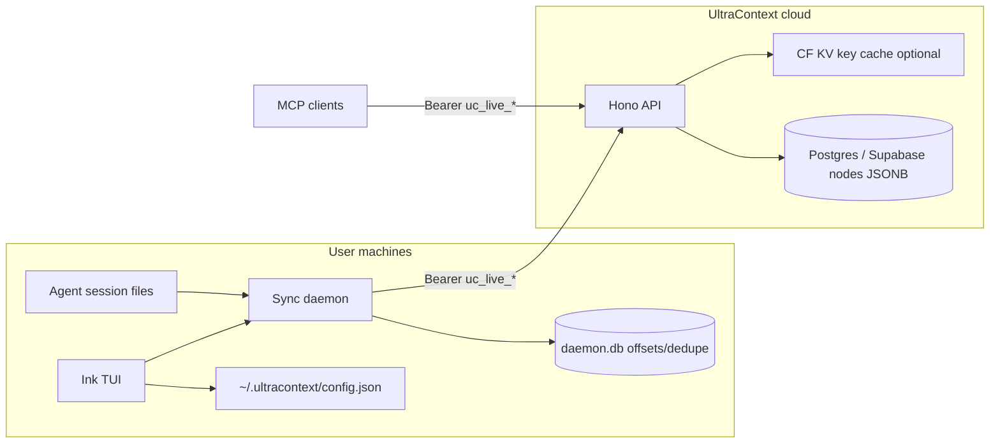
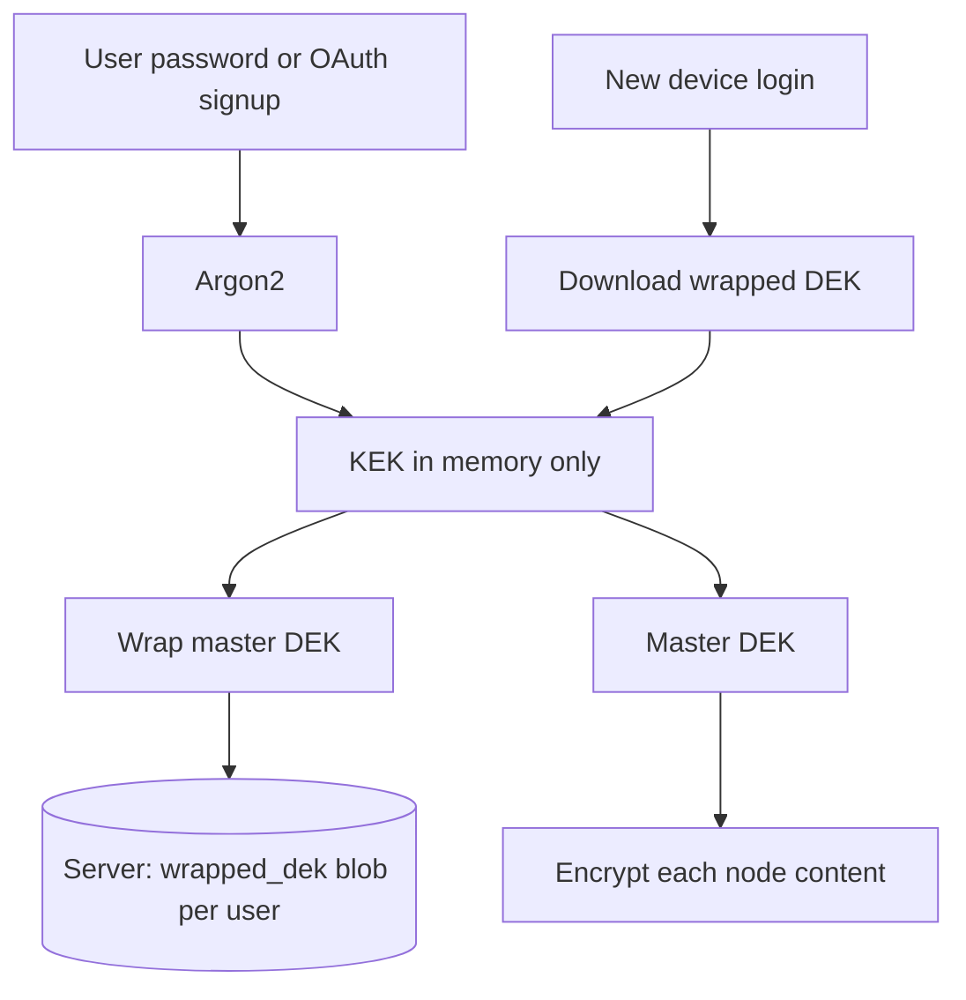
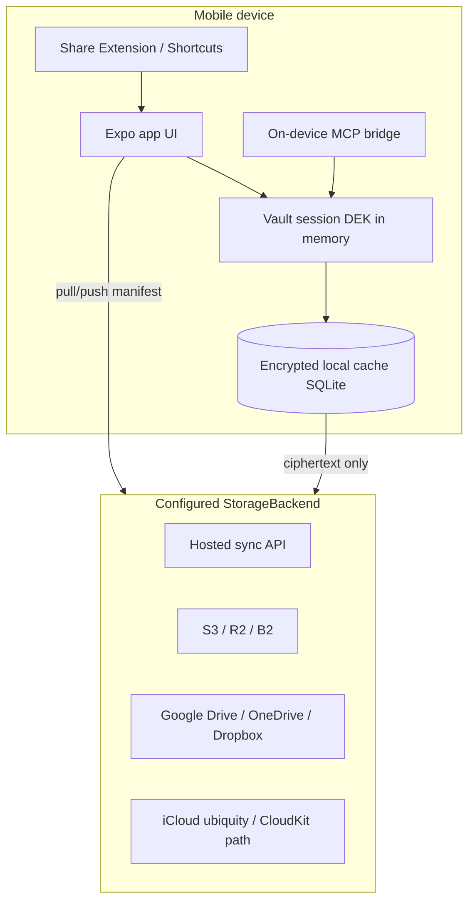
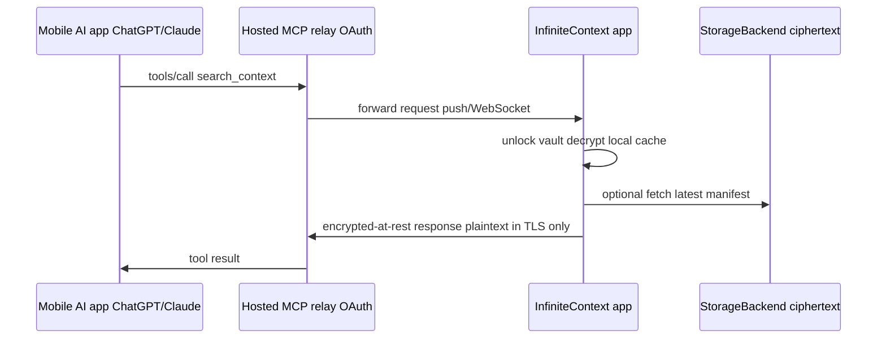
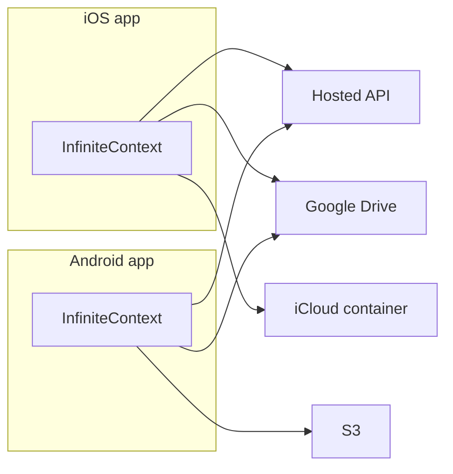

# InfiniteContext — Fork Plan (from UltraContext)

**Prepared for:** Waldo Marais / MantisWare  
**Date:** 2026-10-12  
**Scope:** Research and planning only (no implementation in this document).

---

## Executive summary

UltraContext is an Apache-2.0 monorepo that captures AI agent session logs locally, pushes them to a centralized **Context API**, and exposes git-like versioning (fork, time-travel, soft delete) over message chains stored in PostgreSQL/Supabase. Authentication today is **project-scoped API keys** (`uc_live_…`), not user accounts. The server stores **plaintext JSON** in `nodes.content` and `nodes.metadata`.

InfiniteContext reuses this architecture but adds **zero-knowledge client encryption**, **account-based auth** (email/password + Google, CLI-first), and a **multi-device sync layer** (pull + push, conflicts, incremental sync) on top of encrypted blobs. The fork is legally straightforward under Apache 2.0 (retain notices; do not use UltraContext trademarks without permission), but technically substantial: encryption touches every read/write path, and user auth replaces the API-key tenancy model.

---

## 1. UltraContext today — architecture overview

### 1.1 What it is

- **Product:** “Version control for AI agent context” — realtime ingestion from Claude Code, Codex, OpenClaw, Cursor, Gemini, etc., plus a terminal dashboard (TUI) and MCP tools for cross-agent awareness.
- **Positioning:** Open-source context infrastructure; hosted API at `api.ultracontext.ai`; docs at `ultracontext.ai`.

### 1.2 Language, stack, and repo layout

| Layer | Technology | Location |
|--------|------------|----------|
| Monorepo | pnpm workspaces | Root `pnpm-workspace.yaml`: `apps/*`, `packages/*` |
| Context API | Hono + TypeScript | `apps/api` |
| API runtime | Node (`server.ts`) or Cloudflare Workers (`worker.ts`) | Dual entry via `createApp()` |
| Domain logic | Pure ops + `StorageAdapter` | `packages/core` |
| DB adapters | Drizzle (Postgres) or Supabase REST | `packages/storage` |
| Local ingestion | Node ESM daemon + Ink/React TUI | `apps/sync` |
| Parsers | Agent log parsers + writers | `packages/parsers` |
| JS SDK + CLI | tsdown bundle, global `ultracontext` bin | `apps/js-sdk` |
| Python SDK | httpx, Hatchling | `apps/python-sdk` |
| MCP | stdio + HTTP handlers | `apps/mcp-server` |
| Docs | Mintlify MDX | `apps/docs` |
| Local dev DB | Docker Postgres 5433 | `apps/postgres` |

**Node requirement:** `>=22.12.0` (JS SDK).

### 1.3 How context is stored and loaded

**Server (authoritative today):**

- Schema (`apps/postgres/init.sql`):
  - `projects` — tenant boundary (numeric `id`, optional `public_id`).
  - `api_keys` — `key_prefix` + `key_hash` (SHA-256 of full key), tied to `project_id`.
  - `nodes` — append-only chain per context:
    - `type`: `context` (root) or message types.
    - `content` / `metadata`: **JSONB, plaintext**.
    - `prev_id` linked list; versioning via version marker nodes (`packages/core/src/context-chain.ts`).
    - Public IDs: `ctx_<24 hex>`, `msg_<24 hex>`.

**API surface (`apps/api/src/routes/contexts.ts`):**

- `POST /contexts` — create / fork (`from`, `version`, `at`, `before`).
- `GET /contexts` — list with metadata filters (`source`, `user_id`, `host`, `project_path`, `session_id`, time range).
- `GET/PATCH/DELETE /contexts/:id` — read (version/history), append, update messages, delete.
- `POST /contexts/delete-many` — batch delete.
- Auth: Bearer API key on `/contexts*` and `/mcp`; admin key on `POST /v1/keys`.

**Client (daemon):**

- Watches agent session files; parses via `@ultracontext/parsers`.
- Uses `UltraContext` SDK to **push only** (`create`, append) to remote API.
- Local SQLite (`~/.ultracontext/daemon.db`): dedupe hashes, file offsets, context-id cache — **not** a replica of server context.
- IPC: `~/.ultracontext/config.json`, `status.json` (no WebSocket requirement for core sync; TUI polls status).

**Implication for InfiniteContext:** There is **no** existing bidirectional sync, conflict resolution, or encrypted-at-rest design. The Context API is already centralized but is **key-per-project**, not **user-account** scoped.

### 1.4 Entry points and packaging

| Entry | Command / artifact |
|--------|---------------------|
| Global CLI | `npm install -g ultracontext` → bin `ultracontext` |
| CLI subcommands | default/`sync`, `config`, `switch`, `update`, `stop`, etc. (`apps/js-sdk/src/cli/entry.mjs`) |
| API (local) | `pnpm ultracontext:api` → port 8787 |
| API (prod) | CF Worker `api.ultracontext.ai` (`apps/api/wrangler.jsonc`) |
| MCP stdio | `ultracontext-mcp` (`apps/mcp-server`) |
| npm package | `ultracontext` (SDK + CLI bundled) |
| PyPI | `ultracontext` |

Publish pipeline: GitHub release → npm + PyPI (`.github/workflows/publish.yml`).

### 1.5 License and attribution (must change for MantisWare)

| Item | Current |
|------|---------|
| License | **Apache License 2.0** (root + per-package copies) |
| JS SDK author | `"Ultracontext"` in `apps/js-sdk/package.json` |
| Python author | `UltraContext`, `fabio@ultracontext.ai` in `pyproject.toml` |
| Brand / domains | `ultracontext.ai`, `api.ultracontext.ai`, GitHub `ultracontext/ultracontext` |
| Social | `@ultracontext` (X), Discord invite in README |
| API key prefix | `uc_live_` / `uc_test_` (`packages/core/src/api-keys.ts`) |
| Public ID prefixes | `ctx_`, `msg_` |
| Apache §6 | **Trademark:** cannot imply endorsement; use own product name (InfiniteContext) |

**Recommended for InfiniteContext:** Keep Apache 2.0; add `NOTICE` file crediting UltraContext upstream; set copyright to **Waldo Marais / MantisWare** on new/modified files; register **infinitecontext** npm/PyPI names and domains separately.

### 1.6 Architecture diagram (as-is)



---

## 2. Full rename checklist

Use consistent mappings:

| UltraContext | InfiniteContext (proposed) |
|--------------|----------------------------|
| `ultracontext` | `infinitecontext` |
| `UltraContext` | `InfiniteContext` |
| `@ultracontext/*` | `@infinitecontext/*` |
| `ultracontext-api` | `infinitecontext-api` |
| `ultracontext-mcp-server` / `ultracontext-mcp` | `infinitecontext-mcp-server` / `infinitecontext-mcp` |
| `ultracontext-monorepo` | `infinitecontext-monorepo` |
| `~/.ultracontext` | `~/.infinitecontext` |
| `ULTRACONTEXT_*` env vars | `INFINITECONTEXT_*` |
| `uc_live_` / `uc_test_` | `ic_live_` / `ic_test_` (or keep `uc_` only if legally cleared — prefer new prefix) |
| `api.ultracontext.ai` | `api.infinitecontext.<your-domain>` |
| Python module `ultracontext` | `infinitecontext` |

### 2.1 Repository and monorepo

- [ ] GitHub org/repo name and remote URLs
- [ ] Root `package.json` name + all `ultracontext:*` scripts → `infinitecontext:*`
- [ ] `pnpm-workspace.yaml` (paths unchanged; package names change)
- [ ] `CLAUDE.md`, `AGENTS.md`, `CONTRIBUTING.md`, root `README.md`
- [ ] `.env.example` (root + `apps/api`, `apps/postgres`)
- [ ] `.gitignore` entries referencing `.ultracontext`

### 2.2 npm / pnpm packages (rename + publish scope)

| Current package | Action |
|-----------------|--------|
| `ultracontext` (JS SDK) | Rename; new npm name |
| `ultracontext-api` | Private or deploy-only |
| `@ultracontext/core` | `@infinitecontext/core` |
| `@ultracontext/storage` | `@infinitecontext/storage` |
| `@ultracontext/parsers` | `@infinitecontext/parsers` |
| `@ultracontext/sync` | `@infinitecontext/sync` |
| `ultracontext-mcp-server` | Rename bin + package |

- [ ] Update all `workspace:*` dependencies in `pnpm-lock.yaml` (regenerate via `pnpm install`)
- [ ] `tsdown.config.ts`, import paths, test filters in CI

### 2.3 Binaries and CLI

- [ ] `apps/js-sdk/ultracontext.mjs` → `infinitecontext.mjs`
- [ ] `package.json` `"bin"` entry
- [ ] `PACKAGE_NAME` in `entry.mjs`, help text, postinstall (`ULTRACONTEXT_SKIP_POSTINSTALL`)
- [ ] Plugin paths: `apps/js-sdk/plugin/*` (marketplace, Claude plugin metadata)
- [ ] Skill files referencing `ultracontext switch`

### 2.4 Config directories and local files

| Path / env | Rename |
|------------|--------|
| `~/.ultracontext/config.json` | `~/.infinitecontext/config.json` |
| `daemon.db`, `daemon.lock`, `daemon.log`, `daemon.info`, `status.json` | Same basenames under new dir |
| `ULTRACONTEXT_CONFIG_FILE`, `CONFIG_HOME`, `DB_FILE`, `LOCK_FILE`, `DAEMON_*` | `INFINITECONTEXT_*` |
| `DEFAULT_RUNTIME_CONFIG_FILE` in daemon/tui/onboarding | Update defaults |

**Migration UX:** One-time `infinitecontext migrate-config` copying `~/.ultracontext` → `~/.infinitecontext` (optional import of old API keys if still supported).

### 2.5 Environment variables (API server)

| Current | New |
|---------|-----|
| `ULTRACONTEXT_ADMIN_KEY` | `INFINITECONTEXT_ADMIN_KEY` |
| `DATABASE_*`, `SUPABASE_*` | Unchanged names (generic) |
| Wrangler KV `ULTRACONTEXT_API_KEYS_CACHE` | `INFINITECONTEXT_*` binding name |

### 2.6 Code identifiers

- [ ] Class `UltraContext` → `InfiniteContext`
- [ ] `UltraContextHttpError`, Python `UltraContext` client
- [ ] Log strings, error messages, TUI branding (`hero-art`, `DaemonTui`)
- [ ] `@ultracontext/sync/ui/*` deep imports in js-sdk onboarding
- [ ] Public ID generators (optional: keep `ctx_`/`msg_` for compatibility or migrate to `ictx_`/`imsg_`)

### 2.7 Docs and marketing

- [ ] Entire `apps/docs` (Mintlify `docs.json`, MDX, OpenAPI server URL, screenshots)
- [ ] `apps/js-sdk/README.md`, `apps/python-sdk/README.md`, `apps/postgres/README.md`, `apps/api/README.md`
- [ ] Badges, hero images, external links (replace ultracontext.ai)
- [ ] Hosted docs domain + API reference base URL

### 2.8 Infrastructure and DNS

- [ ] `wrangler.jsonc` worker name, routes, zone
- [ ] Supabase project / Postgres database name (`ultracontext` user/db in compose)
- [ ] Docker compose `POSTGRES_USER` / `POSTGRES_DB`
- [ ] Scripts: `ultracontext-db-migrate.sh`, `ultracontext-dev-key.sh` filenames and contents

### 2.9 CI/CD

- [ ] `.github/workflows/publish.yml` filter names (`pnpm --filter ultracontext`)
- [ ] npm/PyPI secrets under MantisWare org
- [ ] Commitlint scopes (`feat(api):` can stay generic)

### 2.10 License headers

- No per-file copyright headers today (Apache template only in LICENSE files).
- [ ] Add optional `SPDX-License-Identifier: Apache-2.0` + `Copyright 2026 MantisWare` on new files
- [ ] Root `NOTICE` attributing UltraContext upstream per Apache 4(d)

### 2.11 Search-and-replace sanity

Roughly **100+ files** reference `ultracontext` / `UltraContext` (code, docs, workflows). Automate with codemod + manual pass for:
- User-facing strings
- URLs that must not break internal tests
- Legal/trademark strings

---

## 3. Implementation plan — encryption, sync API, auth

### 3.1 Design principles

1. **Zero-knowledge:** Server stores only ciphertext + non-sensitive sync metadata (sizes, timestamps, content hashes, device IDs).
2. **Client-side crypto only** in CLI/SDK; API never receives master keys or password-derived keys.
3. **Separate concerns:** Auth tokens (session/JWT) ≠ data encryption keys (DEK).
4. **Multi-device:** Each device has a keypair or wrapped DEK; account password wraps a **key encryption key (KEK)** used to unwrap DEKs.
5. **Incremental sync:** Content-addressed or revision-based blobs; avoid re-uploading unchanged ciphertext.

### 3.2 Cryptography (recommended)

| Purpose | Algorithm | Notes |
|---------|-----------|--------|
| Password → KEK | **Argon2id** (m=64MB, t=3, p=4) or scrypt | Salt per user, stored server-side |
| Data encryption | **XChaCha20-Poly1305** | 192-bit nonce, libsodium `@noble/ciphers` or `sodium-native` |
| Alternative | AES-256-GCM | Web Crypto friendly; shorter nonce discipline |
| Key wrap | XChaCha20-Poly1305 or AES-KW | Wrap per-device DEK with KEK |
| Random | `crypto.getRandomValues` | DEKs 256-bit |

**Envelope per node (example):**

```json
{
  "v": 1,
  "alg": "XC20P",
  "kid": "dek_2026_01",
  "nonce": "<b64>",
  "ct": "<b64 ciphertext of canonical JSON>",
  "aad": "<optional context_id + type>"
}
```

Store in `nodes.content` as opaque JSON (or move to `BYTEA` column `ciphertext`).

**Search/filter tradeoff:** Today `GET /contexts` filters on plaintext metadata (`source`, `project_path`, …). With ZK:

- **Option A:** Encrypt metadata too; list endpoints return only opaque handles + client decrypts (server indexes nothing sensitive).
- **Option B:** Allow **explicit blind index tokens** (HMAC of filter fields with user-held key) — more complex.
- **Recommendation for v1:** Encrypt message bodies + rich metadata; keep **minimal cleartext index** (account_id, context public_id, created_at, source enum, byte size) only if Waldo accepts partial leakage — document clearly.

### 3.3 Key hierarchy and lifecycle



| Event | Behavior |
|-------|----------|
| **Registration** | Generate DEK; derive KEK from password; upload `wrapped_dek`; never send password or KEK |
| **Login (email)** | Fetch wrapped DEK + salt; derive KEK; unwrap DEK; hold in CLI keychain |
| **Login (Google)** | No password → generate random **account secret** on first OAuth; show **recovery key** once; or require setting a passphrase post-OAuth |
| **Password change** | Derive new KEK'; re-wrap same DEK; rotate `wrapped_dek` version |
| **Forgot password** | **No recovery without backup** (true ZK) OR optional **recovery key** / **escrowed wrap** (security tradeoff) |
| **Multi-device** | Per-device: store `device_id`, `wrapped_dek_device` optional, refresh tokens; DEK in OS keychain (`keytar`) |
| **Logout** | Wipe DEK from memory; clear keychain entry |

**OAuth + ZK tension:** Google login does not give the server a password to derive KEK. Standard pattern:

1. On first Google login, client generates DEK + random **256-bit Account Key**; wraps DEK with key derived from Account Key; stores wrapped blob on server.
2. Account Key stored in OS keychain tied to device.
3. New device: user must **approve via existing device**, scan **recovery QR**, or enter **24-word recovery key** generated at signup.

### 3.4 Sync API — recommended stack and hosting

**Recommendation:** Extend the existing Hono API rather than a separate product, deployed on **Cloudflare Workers + Supabase Postgres** (matches upstream) or **Fly.io/Railway Postgres** if Waldo wants simpler ops.

| Component | Choice | Rationale |
|-----------|--------|-----------|
| HTTP API | Hono (keep) | Already dual Node/Worker |
| Primary DB | Postgres (Supabase) | Relational sync state + blob refs |
| Large blobs | Supabase Storage or R2 | Ciphertext attachments if messages grow |
| Auth | Dedicated `apps/auth` or routes in API | JWT access + refresh |
| Background jobs | CF Queues / Supabase cron | Compaction, tombstone GC |
| CLI | Existing `apps/js-sdk` + sync daemon | Add sync pull loop |

**New / extended data model (conceptual):**

```sql
-- Users and auth (replaces project-per-api-key for consumer product)
users (id, email, email_verified, oauth_google_sub, created_at)
sessions (id, user_id, refresh_token_hash, device_id, expires_at)
user_crypto (user_id, kdf_salt, kdf_params, wrapped_dek, dek_version)

-- Sync state
devices (id, user_id, name, last_sync_at, cursor)
contexts_sync (context_id, user_id, server_revision, head_hash, updated_at)
sync_chunks (context_id, revision, ciphertext_blob, prev_revision, device_id) -- or reuse nodes with encrypted content

-- Optional conflict branch
sync_conflicts (id, context_id, base_revision, left_revision, right_revision, resolved_at)
```

**Sync protocol (phased):**

1. **Cursor pull:** `GET /sync/changes?since=<cursor>` → list of `{context_id, revision, op, ciphertext_ref}`.
2. **Push:** `POST /sync/push` with `{base_revision, mutations[]}` → server returns `{new_revision}` or **409 conflict**.
3. **Conflict policy (default):** Last-writer-wins on context **head** with optional **fork** (aligns with existing `create from` semantics); expose conflict in CLI for manual merge (decrypt both, merge JSON, re-encrypt).
4. **Incremental:** Hash plaintext before encrypt; skip upload if server has same `content_hash` (hash of ciphertext on server).
5. **Versioning:** Retain UltraContext’s linked-list versioning **inside** decrypted payload, or map each API version to a sync revision.

**Daemon changes:**

- Today: push-only append stream.
- Target: **bidirectional** — after local ingest, encrypt → push; periodic pull → decrypt → update local cache (new SQLite tables for encrypted replica or decrypted read model).
- Second machine: no agent files → still **pulls** remote contexts for MCP/TUI.

### 3.5 Auth — email/password + Google, CLI-only

**Identity provider options:**

| Approach | Pros | Cons |
|----------|------|------|
| **Supabase Auth** | Google OAuth + email built-in; JS client | Vendor lock; CLI device flow needs custom |
| **Auth0 / Clerk** | Mature OAuth | Cost; CLI flows |
| **Self-hosted:** `better-auth` / `lucia` + Hono | Full control | More engineering |

**Recommendation:** **Supabase Auth** (if already on Supabase) *or* **Hono + `@auth/core`** with Google + credentials provider, tokens issued by InfiniteContext API.

**CLI flows:**

1. **Email/password:** `infinitecontext login` → prompt password → `POST /auth/login` → receive short-lived JWT + refresh token → store refresh in `~/.infinitecontext/credentials` (0600) → derive KEK locally from password (password never stored).
2. **Google:** **Device authorization flow** (RFC 8628) — CLI prints URL + code; user completes in browser; CLI polls until JWT issued. Alternative: **localhost redirect** (`http://127.0.0.1:53682/callback`) with temporary listener (better UX on desktop).
3. **API requests:** `Authorization: Bearer <access_jwt>` replaces `uc_live_*` for sync routes; optional **device-scoped API keys** derived from account for MCP automation.

**Remove / defer:** API key onboarding paste from ultracontext.ai cloud; admin `POST /v1/keys` becomes internal provisioning only.

### 3.6 Phased milestones and acceptance criteria

#### Phase 0 — Fork and rename (foundation)

**Work:** Execute rename checklist; MantisWare branding; CI publishes to new npm scope; local dev runs.

**Acceptance:**

- `pnpm check` and API tests pass.
- `infinitecontext config` writes `~/.infinitecontext/config.json`.
- No user-visible “UltraContext” strings in CLI help (except optional `--notice` upstream credit).

---

#### Phase 1 — Account auth (no encryption yet)

**Work:** User registration/login; JWT middleware; map `user_id` → storage tenant (replace or wrap `project_id`).

**Acceptance:**

- `infinitecontext login` (email + Google device flow) obtains JWT.
- Daemon refuses to sync without valid session; refresh works across 7 days.
- Existing context CRUD works under user scope with **plaintext** still (intermediate state).

---

#### Phase 2 — Client encryption (single device)

**Work:** Crypto module in `@infinitecontext/core` or `packages/crypto`; encrypt on append/create in SDK; decrypt on get; migration tool for existing plaintext (re-encrypt client-side if user has old API key data — likely N/A for greenfield).

**Acceptance:**

- Server DB inspection shows no readable message content.
- Round-trip: create context → append → get → identical plaintext in CLI.
- Password change re-wraps DEK without re-uploading all nodes (only crypto metadata update).
- Unit tests with fixed test vectors for KDF + AEAD.

---

#### Phase 3 — Multi-device key unlock

**Work:** Recovery key generation/display; optional `infinitecontext devices list|revoke`; wrap DEK for additional devices; Google-first account passphrase setup wizard.

**Acceptance:**

- Second CLI login with recovery key or device approval yields working decrypt.
- Revoked device cannot fetch new DEK wrap.
- Documented **data loss** if password + recovery key lost.

---

#### Phase 4 — Sync API v1 (push + pull, LWW)

**Work:** Sync endpoints; server revision counters; daemon pull loop; conflict returns 409 with both revisions.

**Acceptance:**

- Machine A ingests Claude session; Machine B (no agents) sees same context in TUI within N seconds.
- Simultaneous appends: policy documented; one wins; other gets conflict event in logs.
- Incremental: re-running daemon does not re-upload unchanged ciphertext (byte comparison or hash).

---

#### Phase 5 — Versioning and conflicts (advanced)

**Work:** Align encrypted sync with fork/time-travel; CLI merge for conflicts; MCP reads decrypted view.

**Acceptance:**

- Fork context on B after partial sync on A preserves history.
- MCP tools return decrypted messages (local only).

---

#### Phase 6 — Production hardening

**Work:** Rate limits, audit logs (no plaintext), backup strategy, security review, hosted infra.

**Acceptance:**

- Pen test checklist complete; OWASP ASVS L1 for auth; argon2 params documented.
- Uptime SLO defined; monitoring on sync lag and auth failures.

---

## 4. Ranked product improvements and additions

Effort: **S** (days), **M** (1–2 weeks), **L** (multi-week), **XL** (major).

| Rank | Item | Value | Effort | Notes |
|------|------|-------|--------|-------|
| 1 | Account-based encrypted sync (core vision) | Critical — product differentiator | XL | Phases 1–4 |
| 2 | Recovery key + device management | High — reduces lockout/support pain | M | Required for OAuth-only users |
| 3 | `infinitecontext login` Google device flow | High — CLI-first promise | M | UX make-or-break |
| 4 | Local encrypted cache + offline read | High — TUI/MCP without network | L | SQLite encrypted with DEK |
| 5 | Conflict UI in TUI (merge / fork) | Medium — power users | M | Builds on existing fork API |
| 6 | Encrypted search (blind indexes) | Medium — privacy vs UX | L | Optional premium |
| 7 | Team / org sharing (shared DEK via asymmetric) | High for B2B | XL | New key model |
| 8 | Self-host bundle (Docker Compose) | Medium — enterprise | M | Already documented upstream |
| 9 | Windows native support parity | Medium — audience | M | Path handling, keychain |
| 10 | Attachment / large blob sync (R2) | Medium — long sessions | L | Separate from node JSON |
| 11 | Import from UltraContext export | Low — niche | S | If export exists |
| 12 | Mobile read-only viewer | Low initially | XL | Out of CLI scope |
| 13 | Keep Python SDK | Medium — integrators | M | Same crypto in Python or JS-only |
| 14 | Audit log for compliance | Medium — enterprise | M | Metadata only |
| 15 | Rate limiting + abuse prevention | High — public API | S | CF built-ins |

---

## 5. Risks and open questions for Waldo

### 5.1 Legal and product

1. **Trademark:** Confirm MantisWare may use “InfiniteContext” and that marketing does not imply UltraContext endorsement.
2. **Apache compliance:** Will you ship a `NOTICE` file and retain upstream license texts in distributions?
3. **Dual license / commercial:** Stay Apache 2.0 or add commercial license for hosted service?

### 5.2 Security and ZK semantics

4. **True zero-knowledge vs pragmatic:** Is minimal cleartext indexing (source, timestamps) acceptable for listing contexts?
5. **Forgot password policy:** Strict ZK (total loss) vs recovery key vs optional server-assisted recovery (weakens ZK)?
6. **Google-only users:** Mandate recovery key at signup, or force passphrase after OAuth?
7. **Threat model:** Insider at host, nation-state, client malware — which are in scope for v1?

### 5.3 Technical

8. **Tenant model:** One user = one project, or multiple workspaces per account?
9. **API compatibility:** Break the public Context API or version as `/v2` encrypted-only?
10. **MCP and encryption:** MCP server must decrypt locally — is stdin MCP enough or need HTTP MCP with session?
11. **Performance:** Argon2 on every login vs cached KEK in keychain with TTL?
12. **Conflict UX:** Is LWW sufficient, or is CRDT/merge required for collaborative teams?

### 5.4 Operations

13. **Hosting budget:** Cloudflare + Supabase vs single VPS — expected MAU?
14. **Data residency:** EU-only storage requirement?
15. **Backup:** Encrypted backups are useless without keys — document user responsibility?

### 5.5 Migration from UltraContext

16. Will InfiniteContext import existing **plaintext** UltraContext projects (requires user API key and one-time encrypt upload)?
17. Reuse `ctx_`/`msg_` IDs globally or namespace per account?

---

## 6. Suggested immediate next steps (for Waldo)

1. Confirm **domain**, **npm/PyPI names**, and **ZK policy** (recovery + metadata indexing).
2. Execute **Phase 0 rename** on a new GitHub org repo (fork or mirror).
3. Spike **Phase 1 auth** with Google device flow in CLI (highest UX risk).
4. Parallel spike: **encrypt/decrypt** round-trip in SDK against existing `nodes` schema.
5. Engage legal review for Apache + trademark + “InfiniteContext” branding.

---

## 7. Decisions (Phase 0 update — 2026-10-12)

### 7.1 Key recovery (zero-knowledge)

**Policy:** Strict zero-knowledge. The hosted service never holds the master data encryption key (DEK) or password-derived key encryption key (KEK) in recoverable form.

| Mechanism | Behavior |
|-----------|----------|
| **Registration (email/password)** | Client generates DEK; derives KEK from password (Argon2id); uploads `wrapped_dek` + KDF params. A **recovery key** (high-entropy, e.g. 256-bit encoded for display) is generated and shown **once** at signup. Both password-derived KEK and recovery-key-derived wrap protect the same DEK (dual wrap blobs or equivalent envelope). |
| **Registration (Google OAuth)** | No password at signup → user **must** set a vault passphrase **or** save the one-time recovery key before sync is enabled. Device-local account secret in OS keychain is not sufficient alone for new devices. |
| **New device** | Unwrap DEK via password, vault passphrase, or recovery key (or future device approval flow in Phase 3). |
| **Password change** | Re-wrap same DEK with new KEK; recovery wrap unchanged unless user rotates recovery key. |
| **Loss scenario** | Losing **both** account password/vault passphrase **and** recovery key ⇒ **permanent data loss**. No server-side reset. UX must state this explicitly at signup, in `infinitecontext login` help, and in account settings. |

**Resolved open questions (§5.2):** Forgot-password = no recovery without backup key; Google-only users must set passphrase or use recovery key.

### 7.2 Repository fork

- Upstream history imported from `MantisWare/ultracontext` into `MantisWare/infinitecontext` (Apache 2.0 preserved; root `NOTICE` credits UltraContext).
- Product branding: **InfiniteContext** / **MantisWare** — no UltraContext trademark in user-facing product strings.

---

## 8. Pluggable storage backends (encrypted knowledge base)

**Goal:** After client-side encryption (Phase 2+), only **ciphertext** and non-sensitive sync metadata leave the device. Users choose where ciphertext lives via CLI configuration (`infinitecontext config storage` / `infinitecontext storage use <backend>`).

### 8.1 `StorageBackend` interface (CLI / `@infinitecontext/core` or dedicated `packages/vault-storage`)

All backends implement the same contract so sync logic stays backend-agnostic:

```typescript
type ObjectRef = { key: string; revision?: string; etag?: string };

interface StorageBackend {
  /** Human-readable id, e.g. "hosted", "s3", "webdav" */
  readonly id: string;

  put(path: string, ciphertext: Uint8Array, opts?: { ifMatch?: string }): Promise<ObjectRef>;
  get(path: string): Promise<{ body: Uint8Array; etag?: string } | null>;
  list(prefix: string): Promise<ObjectRef[]>;
  delete(path: string, opts?: { ifMatch?: string }): Promise<void>;

  /** Optional: distributed lock for manifest writes (or use etag preconditions only) */
  acquireLock?(resource: string, ttlMs: number): Promise<{ token: string } | null>;
  releaseLock?(resource: string, token: string): Promise<void>;
}
```

- **Paths:** Content-addressed or hierarchical, e.g. `accounts/{account_id}/manifest.json`, `blobs/{hash}.enc`.
- **Concurrency:** Optimistic concurrency via **ETag / revision** on manifest and blob metadata; failed `ifMatch` → sync layer retries with merge/conflict policy (Phase 4+).
- **Hosted default:** InfiniteContext sync API implements this interface over HTTPS (JWT auth, server revision counters).

### 8.2 Backend catalog

| Backend | Transport | Notes / caveats |
|---------|-----------|-----------------|
| **InfiniteContext hosted** | HTTPS sync API | Default; revision cursors + 409 conflicts |
| **S3 / compatible** | AWS SDK / sigv4 | R2, MinIO, Backblaze B2, Wasabi — bucket + prefix config |
| **Google Cloud Storage** | GCS JSON API | Service account or OAuth bucket scope |
| **SFTP / SSH** | ssh2/sftp | Single-writer recommended; use manifest lock file |
| **WebDAV** | PROPFIND/PUT | Nextcloud, ownCloud, generic DAV |
| **Google Drive** | Drive API v3 | Folder ID; rate limits; use app folder |
| **Microsoft OneDrive / SharePoint** | Graph API | Personal vs site drive selection |
| **Dropbox** | Dropbox API | App folder or full drive (scoped token) |
| **iCloud Drive** | **Local synced folder only** | No public server API — point backend at `~/Library/Mobile Documents/com~apple~CloudDocs/...` on macOS |
| **Local synced folder** | Filesystem | Dropbox/Google Drive/OneDrive **desktop** sync dirs — same semantics as iCloud |
| **Optional: rclone adapter** | Subprocess / rclone RC | Power-user escape hatch; map remote name → list/put/get via `rclone` |

**Platform caveats (document in CLI help):**

- **Folder-based sync clients** (iCloud, generic “sync folder”): eventual consistency, conflict copies (`file (conflicted copy)`). InfiniteContext mitigates with a **signed manifest file** + **per-object versioning** (content hash in filename or sidecar) so the CLI never trusts a single opaque file path.
- **No server-side merge** for pure object stores: conflict resolution is **client-side** — fetch both manifest heads, decrypt if needed, apply fork/LWW policy, write new manifest generation with higher `manifest_version`.
- **iCloud:** read/write only through the user’s synced path; warn that iOS background sync may delay propagation.

### 8.3 Manifest + versioning (serverless sync)

Without a central server, coordination uses an encrypted or plaintext **manifest** (metadata only in cleartext if acceptable: sizes, hashes, revision ids; blob paths encrypted optional):

```json
{
  "manifest_version": 42,
  "account_id": "…",
  "head_revision": "rev_…",
  "objects": [
    { "path": "blobs/sha256:…", "size": 1234, "revision": 3, "prev_revision": 2 }
  ],
  "updated_at": "2026-10-12T00:00:00Z"
}
```

- Writers bump `manifest_version` with compare-and-swap (ETag on S3, lock file on SFTP/WebDAV).
- Readers tolerate stale manifest; periodic full list reconciles orphan blobs.

### 8.4 Phase placement and suggested ordering

**New milestone — Phase 3b / Phase 4 parallel track: Pluggable storage**

| Order | Work | Depends on |
|-------|------|------------|
| 1 | Define `StorageBackend` + in-memory + local filesystem backend (dev/tests) | Phase 2 encryption |
| 2 | **Hosted** backend wired to sync API (default prod path) | Phase 4 sync API |
| 3 | **S3-compatible** backend (covers R2, MinIO, B2, Wasabi) | Phase 2 |
| 4 | **Local synced folder** + docs for iCloud/Dropbox/Google Drive desktop paths | Phase 2 |
| 5 | **WebDAV** + **SFTP** | Phase 2 |
| 6 | **GCS**, **Google Drive**, **OneDrive/SharePoint**, **Dropbox** (OAuth device flow per provider) | Phase 1 auth patterns |
| 7 | **rclone adapter** (optional) | Backends 3–5 stable |

**Acceptance criteria:**

- `infinitecontext storage list` shows configured backends; `infinitecontext storage test` round-trips put/get/delete.
- Switching backend in config does not decrypt on server; ciphertext bytes identical across backends for same logical object.
- Manifest CAS documented; simulated dual-writer test produces detectable conflict (CLI message + exit code), not silent corruption.
- Each backend has integration test (mock or MinIO/WebDAV docker) or documented manual checklist.

**Suggested phase number in roadmap:** **Phase 4.5 — User-chosen ciphertext storage** (after hosted bidirectional sync works, before advanced versioning UI).

---

## 9. Mobile (iOS + Android) — architecture plan

**Scope:** Planning only in Phase 0; no mobile app code yet.

**Primary use case:** Waldo (and power users) run AI assistants on a phone and need them to **query** existing context and **append** new notes, captures, and agent turns — with the same zero-knowledge vault as desktop CLI, synced via the configured `StorageBackend`(s) from §8.

### 9.1 Product surfaces

| Surface | Purpose |
|---------|---------|
| **InfiniteContext mobile app** | Login, unlock vault (biometric), browse/search contexts, quick capture, in-app Q&A over decrypted local cache |
| **Share sheet / system shortcuts** | Send URL, text, screenshot OCR result, or voice memo transcript into a chosen context |
| **MCP for third-party mobile AI apps** | ChatGPT, Claude, Grok, etc. connect via Streamable HTTP + OAuth **without** server-side decryption |
| **Push + background sync** | Notify when sync completes or conflicts need attention; bounded background fetch on iOS |

### 9.2 Client stack comparison and recommendation

| Approach | Pros | Cons |
|----------|------|------|
| **Native Swift (iOS) + Kotlin (Android)** | Best Keychain/Keystore, Share Extension, App Intents, CloudKit, background APIs | Two codebases; duplicates crypto/sync already in TypeScript monorepo |
| **Flutter** | Single UI codebase; decent secure storage plugins | Rewrites SDK integration; weaker story for iOS Share Extension / App Intents unless platform channels |
| **React Native / Expo** | Reuse **`@infinitecontext/core`** crypto, manifest sync, and future `StorageBackend` TS implementations; one team skill set; Expo modules for biometrics and secure store | Secure Enclave “hardware-bound keys” need thin native modules; iOS background limits require careful design |

**Recommendation:** **Expo (React Native) with development builds** (`expo-dev-client`), not Expo Go alone.

- **Shared logic:** TypeScript packages for encryption, manifest CAS, and storage adapters (hosted, S3, Drive, etc.) compiled for Hermes via Metro; platform-specific **native adapters** only where required (OAuth redirect, background tasks, Share Extension).
- **Secrets:** **iOS Keychain** + **Android Keystore** (Expo SecureStore / react-native-keychain) hold refresh tokens and **wrapped DEK**; DEK in memory only while vault is unlocked.
- **Biometrics:** Local unlock gate (Face ID / fingerprint) — does not replace recovery key or passphrase for new devices.
- **iOS Share Extension:** Small **native Swift extension** target (Expo config plugin or bare workflow module) that hands payloads to the main app via app group — acceptable exception to “single codebase” for OS integration.
- **Defer pure native apps** unless Expo hits a hard limit (e.g. CloudKit-heavy iCloud backend — see §9.6).



### 9.3 Remote MCP vs zero-knowledge

Third-party mobile AI apps expect a **hosted** MCP endpoint (Streamable HTTP + OAuth). A **server-side MCP that reads context** necessarily sees plaintext **unless** decryption happens elsewhere.

| Option | ZK fidelity | Mobile AI app compatibility | Summary |
|--------|-------------|------------------------------|---------|
| **(a) On-device MCP bridge** | Strongest | Poor alone — apps don’t talk to localhost | MCP server runs **inside** InfiniteContext app; tools decrypt locally. Works for in-app assistant and macOS-style local MCP, not for ChatGPT’s cloud connector by itself. |
| **(b) Delegated sub-key (scoped, TTL)** | Weakens ZK | Excellent | User opts in; server or MCP holds a **read-only sub-DEK** or pre-decrypted slice for N hours. Clear audit log. |
| **(c) Encrypted search index / selective plaintext** | Partial leak by design | Good search UX | Server stores blind indexes or user-approved plaintext snippets for MCP search only. |
| **(d) Relay to user device** | Strong if relay is dumb | Good when phone online | Hosted MCP is **transport only**; tool calls forwarded to app via WebSocket/APNs wake; **decrypt on phone**. |

**Recommendation (primary): (a) + (d) — device-authoritative decryption with optional dumb relay**

1. **Default:** MCP tools execute **on the phone** (in-app assistant + local bridge). Ciphertext sync runs over §8 backends; MCP never sees DEK.
2. **“Connect external AI app” (opt-in):** InfiniteContext hosts **Streamable HTTP MCP + OAuth** that implements **only** `tools/list` and `tools/call` **proxy** — requests are routed to the user’s **currently unlocked** mobile app (or another registered online device). Relay sees **tool names, correlation IDs, and ciphertext blob IDs**, not message bodies.
3. **If no device online:** MCP returns **503 vault locked / device offline** — fail closed, no server decrypt.
4. **Optional tier (explicit opt-in): (b)** for automation — **scoped read delegation** (max TTL 24h, read-only, subset of contexts) for users who accept weakened ZK; off by default; banner in UX.

**Threat model (v1 mobile MCP):**

| Actor | In scope | Mitigation |
|-------|----------|------------|
| Hosted relay operator | Sees OAuth identity, tool metadata, timing | No DEK; no plaintext storage; TLS + mTLS to device where possible |
| Compromised mobile OS | Malware reads unlocked vault | Biometric gate; short unlock TTL; jailbreak warning |
| Compromised third-party AI app | Over-invokes tools if user connected OAuth | Scoped OAuth client; user approves connection; rate limits; read-only tools by default |
| User enables (b) delegation | Insider at host could read delegated slice | Default off; audit + expiry; not marketed as “zero-knowledge mode” |



### 9.4 Share sheet, shortcuts, offline, background, push

| Capability | iOS | Android |
|------------|-----|---------|
| **Share into context** | Share Extension → app group → main app encrypts + queues upload | `ACTION_SEND` intent + Direct Share target |
| **Shortcuts** | App Intents / Shortcuts: “Append to context”, “Search my context” | App Shortcuts / Google Assistant intents (best-effort) |
| **Offline** | Full read from encrypted SQLite cache; writes queued in **outbox** with manifest bump on reconnect | Same |
| **Background sync** | `BGAppRefreshTask` + `NSURLSession` background transfers; **no guaranteed realtime** — document 15–60 min typical | `WorkManager` + foreground service for large uploads (user-visible notification) |
| **Push** | APNs: sync complete, conflict, “device needed for MCP” | FCM: same |

**Design notes:**

- **Outbox pattern:** Append-only local rows `{id, ciphertext, created_at, sync_state}`; sync worker merges into manifest when network + unlock available.
- **iOS background limits:** Do not promise desktop daemon parity; UI copy: “Sync when app opens or periodically in background.”
- **Notifications:** Opt-in; never include plaintext in push payload — only “3 contexts updated” or “MCP request waiting”.

### 9.5 Mobile × pluggable storage backends

Reuse the same `StorageBackend` interface; mobile ships **subset** first, expanded by provider OAuth maturity.

| Backend | Mobile reachability | Notes |
|---------|---------------------|-------|
| **InfiniteContext hosted** | Excellent | Default; JWT + sync API |
| **S3-compatible** | Excellent | IAM keys or STS in secure store; ideal for power users |
| **Google Drive** | Excellent | OAuth via system browser; Drive API from app |
| **OneDrive / SharePoint** | Good | Microsoft auth library; Graph API |
| **Dropbox** | Good | PKCE OAuth |
| **Google Cloud Storage** | Good | Service account JSON in secure store (advanced) |
| **WebDAV** | Fair | Corporate Nextcloud; certificate pinning option |
| **SFTP** | Fair | SSH keys in secure store; background upload fragile on iOS — warn user |
| **iCloud** | **iOS-native path** | Prefer **CloudKit** or **NSUbiquitousKeyValueStore / iCloud container** for manifest + blobs, not macOS “folder path”. Android: no iCloud — use hosted or other backend |
| **Local synced folder** | N/A on mobile | Desktop-only pattern; mobile uses provider APIs instead |
| **rclone** | Defer | No subprocess on iOS; not viable |

**Multi-backend:** Same as desktop — one **primary** backend in config; optional read replica not in v1.



### 9.6 Phased milestones (mobile track)

Mobile work **starts after Phase 2 encryption** (shared crypto) and **overlaps Phase 4+** (sync). No mobile code in Phase 0.

#### Phase M1 — Vault app shell (read-mostly)

**Work:** Expo app; login (email + Google); unlock vault; download manifest + blobs; encrypted local cache; list contexts (minimal cleartext index per §3.2).

**Acceptance:**

- Login and unlock with biometrics; DEK never logged or sent to server.
- Airplane mode: browse last-synced contexts.
- Hosted `StorageBackend` sync round-trip verified against staging API.

#### Phase M2 — Capture + share

**Work:** Share Extension / Android share target; append encrypted messages; outbox + background upload.

**Acceptance:**

- Share URL from Safari/Chrome into named context; appears on desktop CLI after sync.
- iOS background upload completes for payload &lt; 1 MB within documented window.

#### Phase M3 — Search and in-app Q&A

**Work:** Client-side full-text search over decrypted cache; optional on-device small model or calls user-selected LLM with **retrieved chunks only in prompt** (user API key).

**Acceptance:**

- Search returns results in &lt; 500 ms for 10k messages on mid-range device.
- No server-side search index unless user opts into (c) for MCP.

#### Phase M4 — MCP bridge + relay

**Work:** Local MCP in app; hosted Streamable HTTP relay + OAuth; push-to-wake for tool calls; fail closed when locked/offline.

**Acceptance:**

- OAuth connect flow documented for at least one third-party client that supports remote MCP.
- Security review checklist: relay logs contain no plaintext; penetration test on delegation opt-in (b).

#### Phase M5 — Extra backends on mobile

**Work:** Drive, OneDrive, Dropbox, S3 mobile adapters; iCloud container backend on iOS.

**Acceptance:**

- User can point mobile at same backend config as desktop (shared account linking via QR or deep link import of **non-secret** backend descriptor; secrets via secure enclave).

**Suggested ordering relative to core phases:** M1 after Phase 2 → M2 parallel Phase 4 → M3 after local cache stable → M4 after Phase 1 auth + device registry → M5 with Phase 4.5 storage backends.

### 9.7 Open questions for Waldo

1. **In-app LLM:** Bring-your-own API key only, or MantisWare-hosted inference (impacts ZK for Q&A)?
2. **iCloud as primary for iOS-only users:** Invest in CloudKit-native backend vs always default to hosted sync?
3. **MCP relay SLA:** Is “phone must be online” acceptable for ChatGPT integration, or is opt-in (b) delegation required for demo reliability?
4. **Android parity for Share:** Minimum supported Android version and OEM-specific battery killers — document or fight with foreground service?
5. **App Store review:** Share Extension and background MCP relay — legal/compliance copy for “user-controlled encryption”?
6. **Team contexts on mobile:** Same DEK as personal vault or separate org keys ( ties to §5.3 #8)?
7. **Attachments:** Photos/video from share sheet — same blob pipeline as Phase 4 large-object sync?

---

*Document generated from repository analysis at `ultracontext/ultracontext` monorepo structure as of 2026-10-12. Sections 7–9 added for InfiniteContext / MantisWare Phase 0.*
